# 🌿 Chronicles of Morimar — โครงสร้างการพัฒนาและภาพรวมระบบ (Project Architecture & Roadmap Overview)

เอกสารสรุปแผนงานสถาปัตยกรรม การพัฒนาตามแต่ละเฟส (Phase 1 – Phase 5) การปรับปรุงระบบเชิงลึก และภาพรวมของโปรเจกต์ **Cozy Pixel Life & God Simulator: Chronicles of Morimar** ในปัจจุบัน

---

## 1. ภาพรวมของโปรเจกต์ในปัจจุบัน (Current System Overview)

**Chronicles of Morimar** คือเกมจำลองชีวิตและพระเจ้ามุมมอง 2.5D แบบ Cozy Realistic Hand-Painted ที่ผสมผสาน:
1. **Utility AI & Deep Cognition:** ตัวละครมีสมองนึกคิด ปรัชญาประจำตัว เสียงสะท้อนในใจ (Inner Monologue) และความจำระยะยาว (Episodic Memory บันทึกใน IndexedDB)
2. **Dynasty Succession (ระบบสืบทอดสายเลือด):** เมื่อตัวเอกสิ้นอายุขัย (60 ปี) ผู้เล่นสามารถเลือก 1 ใน 3 ทายาทเพื่อรับช่วงต่อในโลกใบเดิม โดยสืบทอดโบนัสสายเลือดและอารยธรรมข้ามรุ่น
3. **5-Era World Evolution:** ทวีปสามารถวิวัฒนาการผ่าน 5 ยุคสมัย (หิน $\rightarrow$ สำริด $\rightarrow$ ยุคกลาง $\rightarrow$ อุตสาหกรรม $\rightarrow$ อนาคต Solarpunk) พร้อมอาคารและภาพลักษณ์ตัวละครที่เปลี่ยนตามยุค
4. **World Lifespan & Eschaton (อายุขัยของโลกและกาลอวสาน):** กำหนดอายุขัยของทวีปได้ (150, 300, 600 ปี หรือนิรันดร์กาล) พร้อมเผชิญหน้าบททดสอบแห่งกาลอวสาน
5. **God Simulation & Terraforming:** อำนาจพระเจ้าในการปรับภูมิประเทศ (เสกภูเขา ขุดลำธาร เสกผลึกดารา สายฟ้าสวรรค์ และควบคุมสภาพอากาศ/ฤดูกาล)

```mermaid
flowchart TD
    subgraph Core_Loop ["Game Loop & Time Management"]
        TM["TimeManager<br/>(Hero Age vs World Year)"] --> GS["GameScene"]
        GS --> IW["IslandWorld (128x128)"]
        GS --> HA["HeroAgent (Player/Dynasty)"]
        GS --> KM["KingdomManager (Buildings & Pop)"]
        GS --> SDS["SeasonAndDisasterSystem"]
        GS --> HUD["HudOverlay (Studio UI)"]
    end

    subgraph Intelligence ["Cognitive & Behavioral Architecture"]
        HA --> UAI["Utility AI Scoring"]
        HA --> DCE["Deep Cognition Engine"]
        DCE --> IDB[("IndexedDB Episodic Memories")]
    end

    subgraph Dynasty_World ["Dynasty & World Lifespan"]
        HA -->|อายุครบ 60 ปี| Heir["Dynasty Succession Modal<br/>(3 Heir Candidates)"]
        TM -->|ปีโลกครบกำหนด| EndWorld["World Eschaton Modal<br/>(Extend +200y / New Genesis)"]
    end
```



---

## 2. ลำดับการพัฒนาและการปรับปรุงในแต่ละเฟส (Phase-by-Phase Evolution)

### 🌾 Phase 1: ปฐมบทแห่งเกาะจำลองและระบบพื้นฐาน (Foundation & Core Vitals)
*เป้าหมาย: สร้างรากฐานเกมจำลองชีวิตบนผืนดินธรรมชาติ พร้อมการเคลื่อนที่และความต้องการพื้นฐาน*

- **ระบบโลก Simplex Noise (เกาะขนาดใหญ่):**
  - สุ่มเกาะความสูงแบบมีระดับน้ำทะเล (`Deep Water`, `Shallow Water`, `Sand`, `Grass`, `Forest`)
  - วางทรัพยากรธรรมชาติ: พุ่มเบอร์รี่สด, กองไฟศักดิ์สิทธิ์, ต้นไม้ร่มเงา
- **ระบบสถานะพื้นฐาน (Vitals System):**
  - ค่าความอิ่มท้อง (`Hunger`), พลังงาน (`Energy`), พลังชีวิต (`Health`), และอายุขัย (`Age`)
  - วงจรกลางวัน-กลางคืน พร้อมตัวควบคุมความเร็วเวลา (`⏸`, `1x`, `2x`, `4x`, `10x`)
- **การปรับปรุงที่เพิ่มเข้ามาในเฟสนี้:**
  - เพิ่มขนาดทวีปเป็น $128 \times 128$ ไทล์เพื่อรองรับการสำรวจขนาดใหญ่
  - ระบบโปร่งแสงต้นไม้บังตา (`See-Through Foliage`) เพื่อให้เห็นตัวละครตลอดเวลาในมุม 2.5D

---

### 🧠 Phase 2: สมอง Utility AI และช่วงวัยของชีวิต (Utility AI & Life Stages)
*เป้าหมาย: ตัวเอกมีอิสระในการตัดสินใจเลือกทำกิจกรรมอย่างชาญฉลาดตามความจำเป็น และเติบโตตามวัย*

- **ระบบสมอง Utility AI (Scoring System):**
  - คำนวณคะแนนพฤติกรรมตามเส้นโค้งความต้องการ (Response Curves):
    - กินเบอร์รี่ (`eat_berry`), หลับพักผ่อน (`sleep_tree`), ผิงไฟคลายหนาว (`warm_campfire`), ออกสำรวจ (`explore_island`)
  - ระบบ Commitment Bias ป้องกันบอทสับสนเปลี่ยนใจไปมาระหว่างทาง
- **ระบบ 5 ช่วงวัย (Life Stages Progression):**
  - `วัยทารก (1–6 ปี)`: เคลื่อนที่ช้า เผาผลาญพลังงานไว เน้นการนอนหลับ
  - `วัยเด็ก (7–12 ปี)`: ความอยากรู้อยากเห็นสูง เดินสำรวจเกาะได้โบนัส
  - `วัยรุ่น (13–21 ปี)`: สมดุล รวดเร็ว พร้อมเริ่มงานก่อสร้าง
  - `วัยผู้ใหญ่ (22–45 ปี)`: ร่างกายแข็งแกร่งที่สุด เหมาะกับการบุกเบิกและปกป้องเมือง
  - `วัยชรา (46–60 ปี)`: เคลื่อนที่ช้าลงแต่ถ่ายทอดภูมิปัญญา (`Lore EXP`) ได้เร็วกว่าปกติ
- **การปรับปรุงที่เพิ่มเข้ามาในเฟสนี้:**
  - Animation เครื่องมือทำมาหากินขยับตามจริง (ถือขวาน/ค้อน พร้อมเอฟเฟกต์เอียงตัวตอนก้าวเดินและเหวี่ยงเครื่องมือ)
  - ป้ายลอยสถานะและอารมณ์บนศีรษะแบบจัดคิวไม่ซ้อนทับกัน

---

### ⚡ Phase 3: พลังพระเจ้า ฤดูกาล และจิตใต้สำนึกเชิงลึก (God Tools, Climate & Deep Cognition)
*เป้าหมาย: เติมเต็มมิติความเป็น God Simulator สภาพแวดล้อมที่โหดร้าย และระบบความคิดที่ลึกซึ้ง*

- **เครื่องมือพลังพระเจ้า (Divine God Tools & Terraforming):**
  - เสกโขดหินผารูน (`spawn_mountain`), ขุดลำธารขวางสัตว์ร้าย (`terraform_river`), ปลูกพุ่มเบอร์รี่ (`spawn_berry`), เสกแท่นผลึกดารา (`spawn_blessing`), ปล่อยหมาป่าเงา (`spawn_beast`), และสายฟ้าสวรรค์ (`smite_lightning`)
- **ระบบ 4 ฤดูกาลและภัยพิบัติธรรมชาติ (Season & Disaster System):**
  - `ใบไม้ผลิ` (อากาศอบอุ่น พืชโตไว), `ฤดูร้อน` (หิวน้ำ/อาหาร), `ใบไม้ร่วง` (เตรียมเสบียง), `ฤดูหนาว` (อุณหภูมิติดลบ หากไม่ผิงไฟพลังชีวิตจะลดลง)
  - ภัยพิบัติสุ่มเกิด: ไฟป่าหมื่นลี้ (`Wildfire`), พายุหิมะยะเยือก (`Blizzard`), ฝนดาวตก (`Meteor Shower`), แผ่นดินไหว (`Earthquake`)
- **ระบบสมอง Deep Cognition Engine:**
  - **ปรัชญาประจำตัว (Worldview/Creed):** เช่น วิถีแห่งพงไพร, ลัทธิปัญญาแสงดารา, หรือวิถีแห่งความแกร่ง
  - **Inner Monologue & Chain-of-Thought:** เสียงสะท้อนในใจและลำดับเหตุผลที่บอทคิดก่อนลงมือทำ
  - **Episodic Memories (IndexedDB):** บันทึกเหตุการณ์สำคัญในชีวิตลงฐานข้อมูลเบราว์เซอร์อย่างถาวร

---

### 🏰 Phase 4: อาณาจักร วิวัฒนาการ 5 ยุคสมัย และผู้ติดตาม (Kingdom, 5 Eras & Followers)
*เป้าหมาย: พัฒนาจากตัวเอกคนเดียวสู่การสร้างหมู่บ้านและขับเคลื่อนอารยธรรมมนุษยชาติ*

- **วิวัฒนาการอารยธรรม 5 ยุคสมัย (Eras Roadmap):**
  1. `ยุคหิน (Stone Age)`: กระท่อมหนังสัตว์ กองไฟบูชาหิน
  2. `ยุคสำริด (Bronze Age)`: กระท่อมฟางทรงกลม รั้วไม้ป้องกันภัย
  3. `ยุคกลาง (Medieval Age)`: คฤหาสน์หิน โรงตีเหล็ก แปลงเกษตรกรรม
  4. `ยุคอุตสาหกรรม (Industrial/Modern Age)`: สถาปัตยกรรมอิฐแดง กระจก และอาคารบริหาร
  5. `ยุคอนาคต (Solarpunk Future Age)`: โดมชีวภาพอาร์โคโลจีและพลังงานสะอาด
- **ระบบก่อสร้างและการสะสมทรัพยากร:**
  - ตัวเอกและชาวบ้านตัดไม้ ขุดหิน และสะสมเสบียงเพื่อตั้งเขตก่อสร้าง (`Construction Site`)
  - อัปเกรดสิ่งปลูกสร้าง: บ้านพักอาศัย, หอคอยสังเกตการณ์, แปลงฟาร์ม, โรงตีเหล็ก
- **ระบบประชากรผู้ติดตาม (Autonomous Followers):**
  - เมื่อสร้างบ้านเพิ่ม จะมีชาวบ้านเดินทางมาเข้าร่วมอาณาจักร ช่วยงานเก็บเกี่ยว ทำฟาร์ม และก่อสร้าง

---

### 👑 Phase 5 (เฟสปัจจุบัน): ปฐมกาลสร้างตัวละคร ระบบสืบทอดทายาท และกาลอวสานโลก (Genesis, Dynasty & Eschaton)
*เป้าหมาย: รองรับการเล่นระยะยาวข้ามรุ่นตระกูล กำหนดชะตาโลก และแก้ปัญหางานภาพให้เป็น Cozy Realistic สมบูรณ์*

- **คืนค่าภาพศิลป์ Cozy Realistic Hand-Painted 2.5D:**
  - นำ Sprite Sheet วาดมือดั้งเดิมกลับมาใช้ทั้งหมด พร้อมตัดขอบเนียนนุ่ม (`Soft-Edge Feathering`)
  - เพิ่ม Sprite Sheet สิ่งปลูกสร้าง 5 ยุคแบบวาดมือสไตล์ Cozy Realistic ([`hd_eras_sheet.jpg`](file:///c:/Users/klaza/OneDrive/%E0%B9%80%E0%B8%94%E0%B8%AA%E0%B8%81%E0%B9%8C%E0%B8%97%E0%B9%87%E0%B8%AD%E0%B8%9B/Cozy%20-%20God%20simulator/public/assets/sprites/hd_eras_sheet.jpg))
- **หน้าสร้างตัวละครและกำหนดชะตาโลกก่อนเริ่มเกม (Genesis Modal):**
  - หยุดเวลาชั่วคราวเพื่อให้ผู้เล่นตั้งชื่อ, นามตระกูล, เลือกช่วงวัยเริ่มต้น (`1, 7, 14, 22 ปี`), จัดสรรแต้ม `STR / INT / AGI`, เลือกสีอาภรณ์, และอุปนิสัย
  - กำหนดอายุขัยของโลก (`maxWorldYears`: 150, 300, 600 ปี หรือ $\infty$) และระดับความรุนแรงของภัยพิบัติ (`Cozy / Balanced / Cataclysm`)
- **ระบบสืบทอดสายเลือดตระกูล (Interactive Dynasty Heir Succession):**
  - เมื่อตัวเอกสิ้นอายุขัยในวัย 60 ปี หรือกดสืบทอดทายาท ระบบจะสุ่มทายาท 3 สายให้ผู้เล่นเลือกเล่นต่อ:
    1. *สายผู้พิทักษ์ (Guardian)*: `STR +2`
    2. *สายปราชญ์ (Scholar)*: `INT +2`
    3. *สายนักบุกเบิก (Pioneer)*: `AGI +2`, เริ่มวัยเยาว์ 7 ปี
  - ตัวเอกคนใหม่รับช่วงต่อใน **โลกใบเดิม เมืองเดิม และยุคสมัยเดิม**
- **ระบบอายุขัยของโลกและกาลอวสาน (World Lifespan & Eschaton):**
  - นับอายุโลก (`worldYear`) ข้ามรุ่น เมื่อใกล้ครบกำหนดจะเกิดฝนดาวตกเตือนลางบอกเหตุ
  - เมื่อถึงกาลอวสาน จะเปิดหน้าต่างสรุปผลประวัติศาสตร์โลก พร้อมตัวเลือก `✨ ประทานพรต่ออายุขัยโลก +200 ปี` หรือ `🌱 กำเนิดจักรวาลใหม่`

---

## 3. โครงสร้างไฟล์ในปัจจุบัน (Project Directory Structure)

```
c:\Users\klaza\OneDrive\เดสก์ท็อป\Cozy - God simulator\
├── index.html                   # Entry Point พร้อมหน้าจอ Studio Loading Bar
├── package.json                 # การตั้งค่าโปรเจกต์และ Dependency (Phaser 3, Simplex Noise, Vite)
├── PROJECT_ROADMAP_OVERVIEW.md  # เอกสารโครงสร้างการพัฒนาและแผนงานฉบับเต็ม
├── public/assets/
│   ├── data/                    # JSON Data-Driven Configs
│   │   ├── agent_config.json    # ค่าสมดุลตัวละคร ความหิว พลังงาน และช่วงวัย
│   │   ├── biomes.json          # กำหนดประเภทพื้นดิน ไบโอม และความสูง
│   │   ├── buildings.json       # พิมพ์เขียวสิ่งปลูกสร้างและค่าใช้จ่ายทรัพยากร
│   │   ├── traits.json          # ตารางคุณลักษณะพิเศษ (Traits)
│   │   ├── weather_events.json  # สภาพอากาศและภัยพิบัติ
│   │   └── world_config.json    # ขนาดแผนที่ 128x128 และมาตราส่วน Noise
│   └── sprites/                 # ภาพประกอบ Cozy Realistic 2.5D Sprite Sheets
│       ├── hd_buildings_sheet.jpg
│       ├── hd_characters_sheet.jpg
│       ├── hd_eras_sheet.jpg    # สิ่งปลูกสร้าง 5 ยุคสมัย (หิน -> อนาคต)
│       ├── hd_flora_sheet.jpg
│       ├── hd_kingdom_sheet.jpg
│       └── hd_phase3_sheet.jpg
└── src/
    ├── main.ts                  # ตัวตั้งต้น Phaser Game Instance
    ├── core/
    │   ├── GameScene.ts         # Scene หลัก เชื่อมต่อ World, Agent, Kingdom, HUD, Camera
    │   ├── PixelTextures.ts     # เจนเนอเรเตอร์เทกซ์เจอร์สำรองและไอคอน
    │   ├── SpriteSheetProcessor.ts # ระบบสกัดและเบลนด์ภาพวาด 2.5D พร้อม Era Swapping
    │   ├── TimeManager.ts       # ระบบนับเวลาจำลอง (Hero Age Timer vs World Year)
    │   └── Types.ts             # Interface และ Data Contracts ทั้งหมด
    ├── agent/
    │   ├── DeepCognitionEngine.ts # ปรัชญา, เสียงสะท้อนในใจ, ความจำ IndexedDB
    │   └── HeroAgent.ts         # พฤติกรรมตัวเอก, A* Pathfinding, Utility AI, Heir System
    ├── kingdom/
    │   └── KingdomManager.ts    # ผังเมือง การก่อสร้าง เทคโนโลยี 5 ยุค และชาวบ้าน
    ├── world/
    │   ├── IslandWorld.ts       # ภูมิประเทศ 128x128, ไบโอม, ระบบตัดโปร่งแสง
    │   └── SeasonAndDisasterSystem.ts # 4 ฤดูกาล อุณหภูมิ และภัยพิบัติ
    └── ui/
        └── HudOverlay.ts        # UI แผงควบคุมพระเจ้า, ผังอารยธรรม, Genesis Modal, Heir Modal
```

---

## 4. แผนการขยายผลในอนาคต (Future Roadmap & Vision)

1. **ระบบปฏิสัมพันธ์ระหว่างเผ่า (Rival Clans & Diplomacy):**
   - เพิ่มชนเผ่าเพื่อนบ้านในทวีปที่พัฒนาตามยุคสมัยของตนเอง
   - มีระบบค้าขายทรัพยากร แลกเปลี่ยนภูมิปัญญา หรือการป้องกันเมืองจากกลุ่มโจร
2. **ระบบพันธุกรรมขั้นสูง (Genetic Inheritance & Traits Mutation):**
   - การจับคู่สายเลือดเพื่อส่งต่อยีนเด่นและยีนด้อยข้ามหลายเจเนอเรชัน
3. **ระบบชีวนิเวศน์สัตว์ป่าแบบครบวงจร (Living Wildlife Ecosystem):**
   - สัตว์กินพืช (กวาง, กระต่าย) ที่กินพุ่มไม้ และสัตว์นักล่าที่ออกล่าเป็นฝูง
4. **Hybrid LLM Runtime สำหรับ Deep Thinking:**
   - เชื่อมต่อ API ภายนอกเพื่อสร้างบทกวี จารึกโบราณ หรือไดอะล็อกการพูดคุยที่มีมิติทางวรรณกรรมเฉพาะตัวของแต่ละตระกูล
